# Nyawtat

Aplikasi pribadi yang menggabungkan **jurnal harian** dan **catatan keuangan** dalam satu timeline. Nama "Nyawtat" dari *nyaw* (suara kucing) + *catat*. Offline-first: semua data tersimpan di HP, lalu disinkronkan ke cloud kalau login.

> Repo ini bernama `djournal` (nama awal proyek). Versi terbaru: **0.9.2**, lihat [CHANGELOG.md](CHANGELOG.md).

<table>
  <tr>
    <td align="center">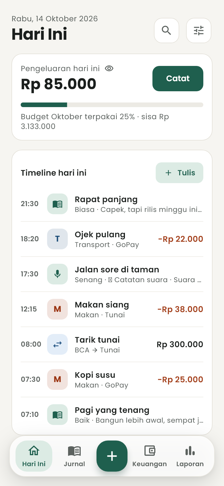<br><b>Hari Ini</b></td>
    <td align="center">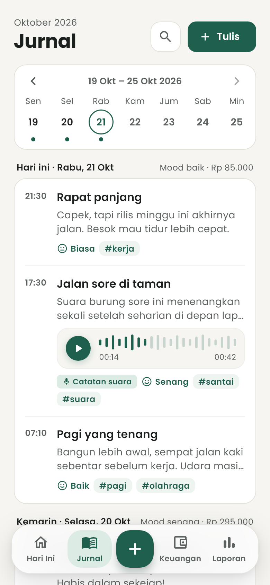<br><b>Jurnal</b></td>
    <td align="center">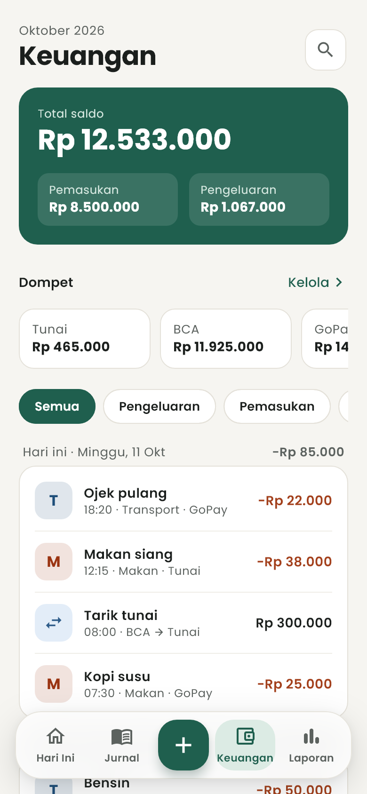<br><b>Keuangan</b></td>
  </tr>
  <tr>
    <td align="center">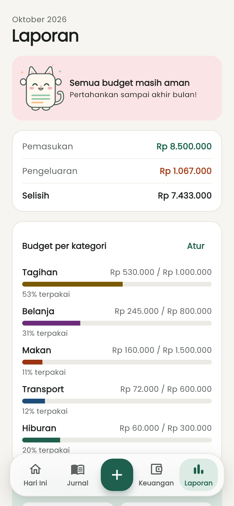<br><b>Laporan</b></td>
    <td align="center"><br><b>Tulis jurnal</b></td>
    <td align="center">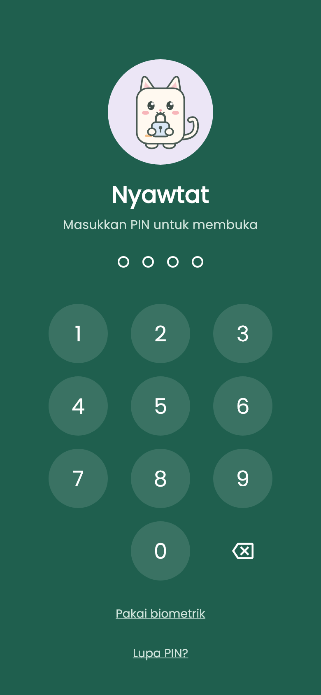<br><b>Kunci PIN</b></td>
  </tr>
  <tr>
    <td align="center">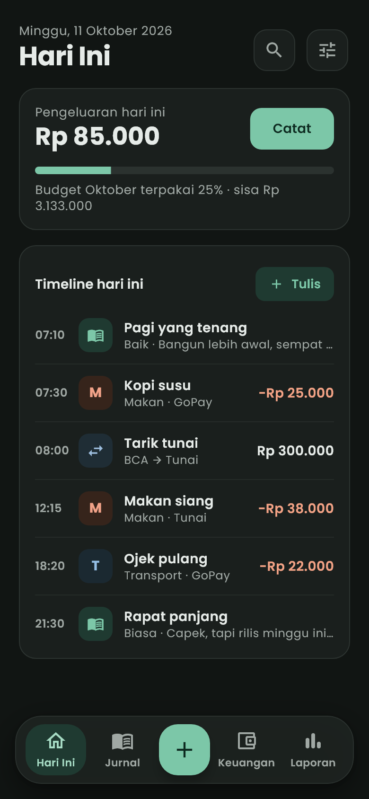<br><b>Mode gelap</b></td>
    <td align="center">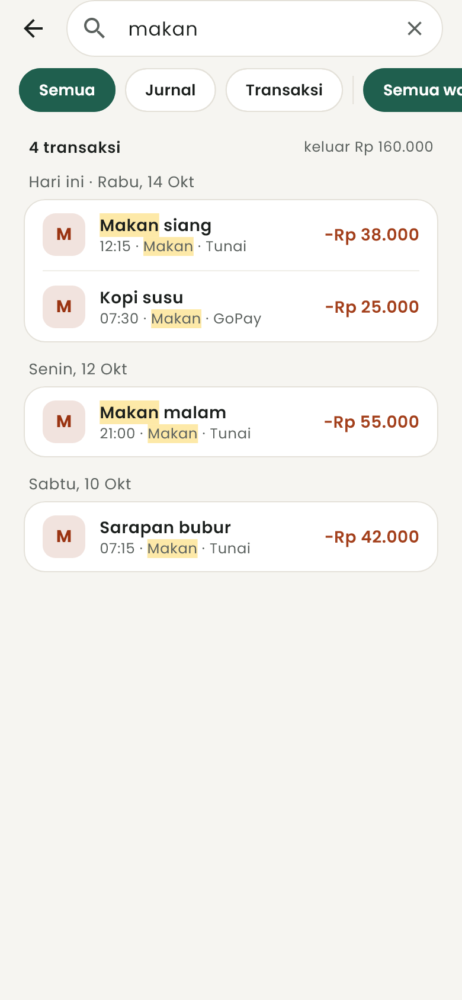<br><b>Pencarian</b></td>
    <td align="center">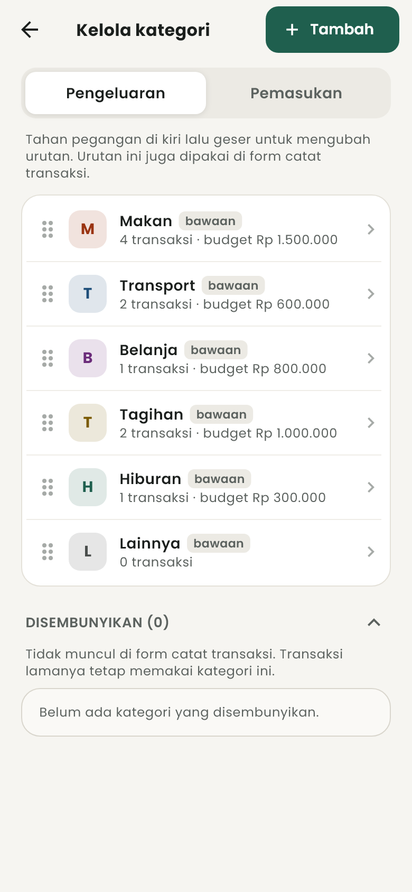<br><b>Kelola kategori</b></td>
  </tr>
  <tr>
    <td align="center">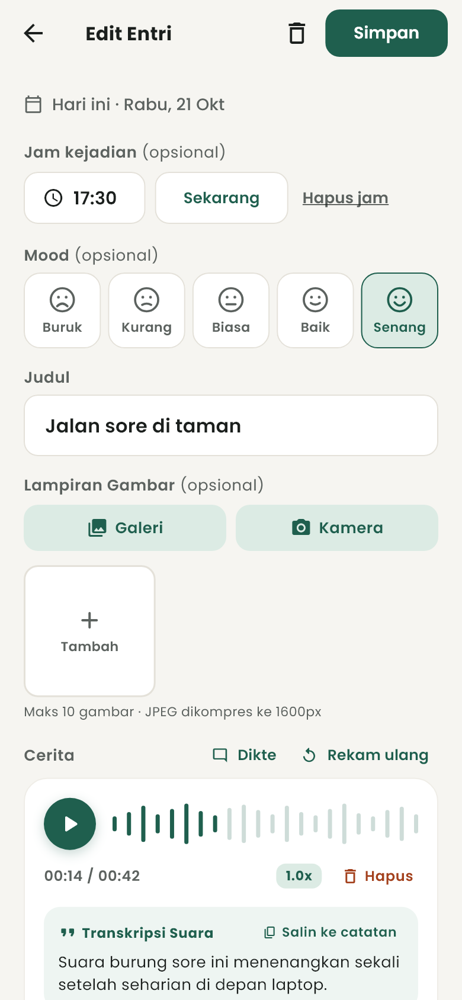<br><b>Catatan suara</b></td>
    <td align="center">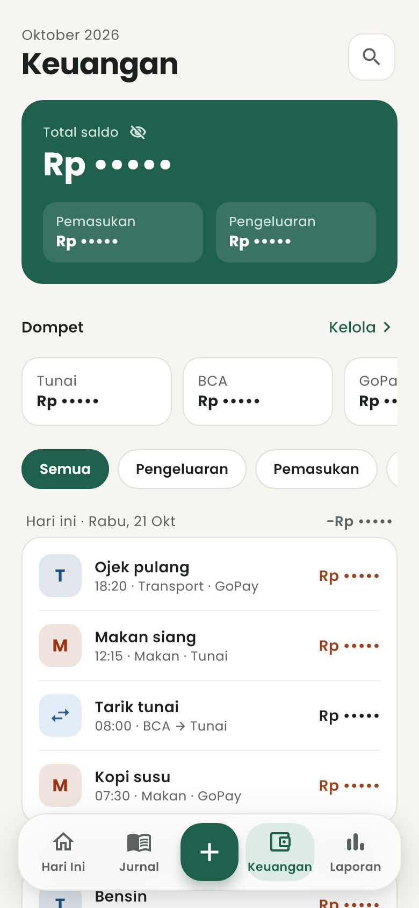<br><b>Mode privasi</b></td>
    <td align="center">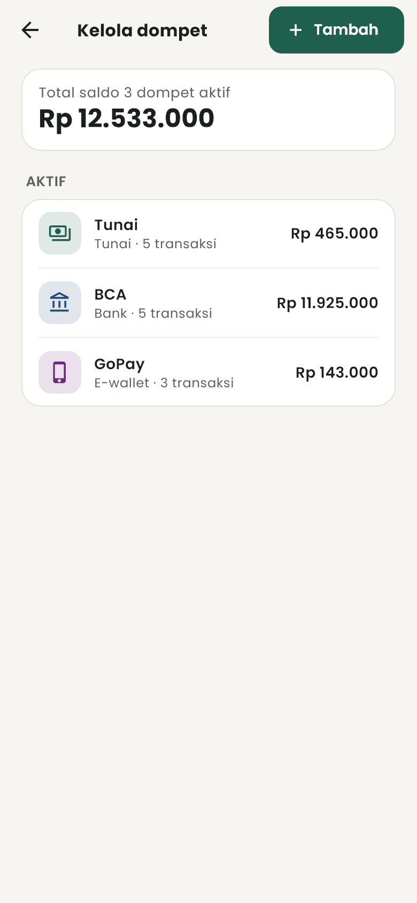<br><b>Kelola dompet</b></td>
  </tr>
</table>

<sub>Screenshot memakai data contoh dan dibuat otomatis dengan <code>flutter test tool/screenshots_test.dart</code>. Prototipe interaktif tersedia di <code>docs/google-drive-prototype/</code>.</sub>

## Pasang

1. Unduh **`app-arm64-v8a-release.apk`** (~24 MB) dari [Releases](../../releases/latest). HP lama yang gagal memasangnya: pakai `app-armeabi-v7a-release.apk`.
2. Buka file itu di HP lalu pilih **Instal**. Versi baru bisa langsung dipasang di atas versi lama; data tetap aman.

> Untuk membangun APK rilis sendiri dengan ukuran teroptimasi (~24 MB, hemat 67% dibanding fat APK):
> ```powershell
> cd app
> flutter build apk --release --split-per-abi --obfuscate --split-debug-info=build/app/outputs/symbols
> ```

> Sejak 30 September 2026, Android di Indonesia hanya mau memasang app dari developer yang terverifikasi. Nyawtat sudah terdaftar di Android Developer Console dengan distribusi terbatas, jadi HP harus **diizinkan developer dulu** (maksimal 20 HP). Tanpa itu muncul pesan "Aplikasi diblokir untuk melindungi perangkat Anda".

## Fitur

**Jurnal & Catatan Suara**
- Beberapa entri per hari, masing-masing dengan jam (opsional), mood 1–5 (opsional), judul, isi, dan tag
- **Lampiran Gambar Jurnal**: lampirkan hingga 10 foto per entri dari kamera atau galeri, kompresi on-device (JPEG 80%, maks 1600px), grid pratinjau responsif, thumbnail di feed Jurnal, dan indikator foto di linimasa Hari Ini
- **Fullscreen Image Viewer**: pratinjau gambar layar penuh dengan gestur cubit-zoom (*pinch-to-zoom*), geser (*pan & swipe* antar gambar)
- **Catatan Suara (Voice Note)**: rekam suara asli (format AAC/M4A hemat ruang) dengan kartu pemutar interaktif (*seekable waveform*, tombol play/pause, dan kontrol kecepatan 1.0x, 1.5x, 2.0x)
- **Dikte Suara**: bicara langsung dan ucapan diubah menjadi teks (*speech-to-text*) secara on-device ke dalam cerita entri jurnal
- Teks transkripsi suara otomatis terindeks dan bisa dicari di Pencarian
- Strip minggu yang bisa ditap untuk memfilter entri per tanggal, plus panah untuk pindah minggu
- Mood harian = rata-rata mood entri hari itu

**Keuangan**
- Dompet (tunai, bank, e-wallet, lainnya): tambah, ubah saldo (penyesuaian otomatis), arsipkan, hapus
- **Foto Struk / Bukti Belanja**: lampirkan foto struk belanja di transaksi dengan pratinjau proporsional dan ikon nota `🧾` di linimasa Hari Ini & riwayat transaksi
- **Mode Privasi**: sembunyikan semua nominal uang (`Rp •••••`) dengan ikon mata instan di kartu saldo/pengeluaran atau sakelar permanen di Pengaturan Keamanan
- Transaksi pemasukan/pengeluaran per kategori; saldo selalu dihitung dari transaksi
- Transfer antar dompet (mis. tarik tunai BCA → Tunai), tidak dihitung sebagai pemasukan/pengeluaran
- Kelola kategori: urutkan, ubah nama/warna/ikon, sembunyikan, gabungkan, hapus
- Budget bulanan per kategori yang berlanjut ke bulan berikutnya
- Laporan & Grafik Pengeluaran: Donut Chart interaktif per kategori, Bar Chart tren mingguan (4–5 minggu), navigasi bulan sebelumnya/berikutnya, serta hubungan mood dan pengeluaran

**Google Drive & Manajemen Data Pintar**
- **Cadangan Google Drive Otomatis**: simpan riwayat aman langsung di Google Drive Anda sendiri
- **Format Excel (.xlsx) Siap Google Sheets**: file cadangan diunggah sebagai spreadsheet Excel yang bisa langsung dibuka, dibaca, dan dianalisis di Google Sheets (4 lembar kerja: `📑 Transaksi`, `📖 Jurnal`, `💵 Dompet`, `🎯 Budget`)
- **Buka di Google Sheets**: tombol cepat untuk membuka dan melihat spreadsheet langsung di browser atau app Google Sheets
- **Pemulihan 100% Utuh**: data sistem cadangan tertanam di sheet sistem file Excel sehingga pemulihan dari Google Drive mengembalikan seluruh relasi database secara utuh
- **Filter Rentang Waktu (Period Range Filter)**: pilihan rentang cadangan fleksibel:
  - *Semua Riwayat*: seluruh riwayat dari awal pemakaian s.d. saat ini
  - *Tahun Ini*: riwayat 1 tahun kalender penuh
  - *Bulan Ini*: riwayat bulan berjalan
  - *Rentang Kustom*: pemilih rentang tanggal bebas (*Date Range Picker*)
- **Menu Data yang Disederhanakan**:
  - **📤 Cadangkan Data (Ekspor)**: satu modal untuk memilih format (Excel `.xlsx` / Cadangan `.json`) dan rentang waktu
  - **📥 Pulihkan / Impor Data**: satu pintu pemulihan dengan deteksi otomatis (*auto-detection*) untuk file `.json` Nyawtat, file `.xlsx` Nyawtat, maupun database Money Manager (`.mmbak`/`.sqlite`/`.xlsx`)
- **Masuk dengan Google (Google Sign-In)**: otentikasi cepat satu ketukan

**Hari Ini & Gamifikasi Rutinitas**
- Satu linimasa descending (terbaru di atas) yang mencampur entri jurnal dan transaksi, kartu tagihan mendatang, kartu wishlist impian, serta bar budget.
- **🔥 Gamifikasi Streak Api**: Ikon streak rutinitas yang menyala setiap kali menyelesaikan minimal satu aktivitas hari ini (menulis jurnal, mencatat transaksi keuangan, atau menabung).
- **🎯 Target Budget Global & Peringatan Ambang Batas**: Limit budget pengeluaran terpadu (Harian, Mingguan, atau Bulanan) dengan status 3 tingkat: Aman (<75%), Waspada (75%–99%), dan Bahaya / Overbudget (≥100%) dengan banner peringatan merah.
- **✨ Target Wishlist & Tabungan Pintar**: Impian belanja terencana dengan kalkulasi otomatis target simpanan per bulan/hari, pilihan alokasi dompet simpanan, serta modal tambah tabungan cepat (*deposit sheet*).
- **🔔 Pengingat Tagihan & Bayar Cepat**: Pengingat tagihan berulang/berkala dengan deteksi dini mendekati jatuh tempo (H-3 s.d. hari ini) dan tombol Bayar Cepat langsung dari linimasa.

**Lainnya**
- Pencarian jurnal dan transaksi (teks, tag, kategori, dompet, nominal) dengan filter jenis dan periode
- Mode gelap (Sistem / Terang / Gelap), termasuk splash dan widget layar utama
- Login dan sinkronisasi antar-device lewat Supabase (last-write-wins, soft delete)
- Kunci PIN 4 digit + sidik jari/wajah; build rilis memblokir screenshot dan pratinjau di daftar app terbaru
- Widget layar utama Android: **Ringkas** 2×2, **Hari ini** 4×2, **Jurnal cepat** 4×1. Nominal disembunyikan otomatis saat PIN aktif; widget jurnal tidak pernah menampilkan isi entri.
- Bahasa Indonesia dan Inggris
- Maskot kucing di layar kosong, layar PIN, dan notifikasi

Platform: **Android** (utama) dan **Web**. iOS belum diuji.

## Teknologi

| Bagian | Stack |
|---|---|
| App | Flutter 3.47, Riverpod 3, Drift (SQLite), gen-l10n |
| Backend | Supabase (Auth + PostgreSQL + fungsi SQL `sync_push`/`sync_pull`) |
| Widget Android | `home_widget` + RemoteViews (Kotlin) |
| Arsip | ASP.NET Core (.NET 10) di `server/`, tidak dipakai lagi |

## Struktur repo

```
djournal/
├─ app/        # Aplikasi Flutter, lihat app/README.md
├─ supabase/   # Migrasi SQL + uji sync, lihat supabase/README.md
├─ server/     # Backend .NET lama (diarsipkan)
└─ docs/
   ├─ data-model.md      # Skema tabel, aturan sync, keputusan cakupan
   └─ setup-windows.md   # Menyiapkan Flutter + Android SDK tanpa Android Studio
```

## Mulai

1. Siapkan toolchain: [docs/setup-windows.md](docs/setup-windows.md)
2. Siapkan backend Supabase (sekali saja): [supabase/README.md](supabase/README.md)
3. Jalankan app dari folder `app/`:

   ```powershell
   flutter pub get
   ```
   ```powershell
   flutter run
   ```

Detail pengembangan (struktur kode, test, alat bantu) ada di [app/README.md](app/README.md).