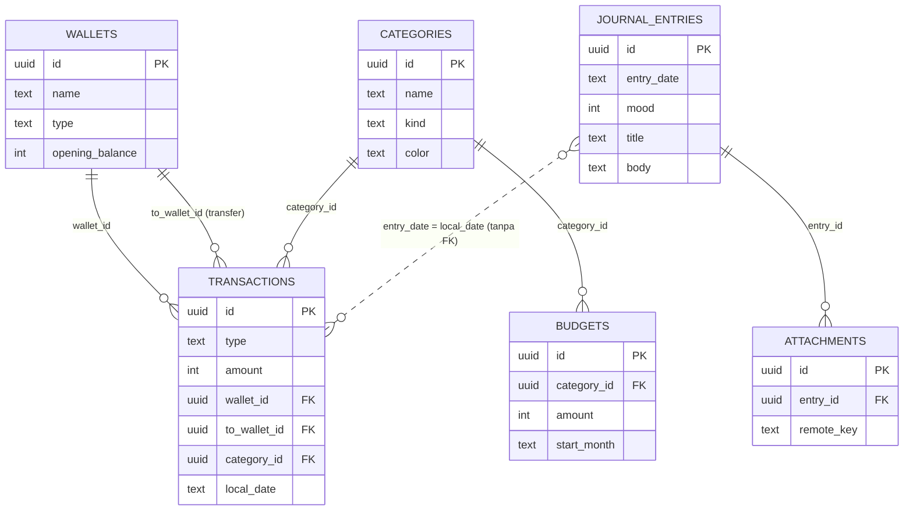

# Data Model — djournal (Jurnal + Keuangan)

Status: draft v0.1 · 8 Oktober 2026

Dokumen ini menjadi acuan untuk:
- **Client** (Flutter): database lokal SQLite via [Drift](https://drift.simonbinder.eu/)
- **Server** (ASP.NET Core): PostgreSQL via EF Core + Npgsql

Desain UI: lihat canvas prototype (alur aplikasi, layar mobile, layar web).

---

## 1. Prinsip desain

| Keputusan | Alasan |
|---|---|
| **ID = UUID yang dibuat di client** (bukan auto-increment) | Data dibuat offline di beberapa device. UUID tidak bentrok saat sync. |
| **Nominal uang = `INTEGER`** dalam Rupiah | Jangan pernah `float`/`double` untuk uang. Di C# pakai `long`, di Dart `int`. |
| **Satu mata uang: Rupiah (IDR)** | Tidak ada kolom mata uang. Multi-currency di luar cakupan MVP. |
| **Saldo tidak disimpan**, selalu dihitung | Saldo yang disimpan gampang tidak sinkron antar device. Dihitung dari saldo awal + transaksi. |
| **Soft delete** (`deleted_at`) | Hapus harus ikut tersinkron ke device lain (tombstone). |
| **Semua timestamp UTC** (epoch ms di SQLite, `timestamptz` di Postgres) | Konsisten lintas zona waktu. |
| **Tanggal lokal disimpan terpisah** (`local_date` = `YYYY-MM-DD`) | "Hari ini" mengikuti zona waktu user, bukan UTC. Ini kunci penghubung jurnal ↔ transaksi. |
| **Jurnal ↔ transaksi dihubungkan lewat tanggal**, bukan foreign key | Sesuai desain: entri jurnal menampilkan semua transaksi di hari yang sama. Tidak perlu tabel relasi. |

---

## 2. Diagram



---

## 3. Kolom standar (ada di SEMUA tabel yang disinkronkan)

| Kolom | SQLite (client) | Postgres (server) | Keterangan |
|---|---|---|---|
| `id` | `TEXT` PK | `uuid` PK | UUID v4 dari client |
| `created_at` | `INTEGER` | `timestamptz` | UTC |
| `updated_at` | `INTEGER` | `timestamptz` | UTC, diubah setiap edit. Dipakai untuk resolusi konflik. |
| `deleted_at` | `INTEGER NULL` | `timestamptz NULL` | Soft delete |
| `is_dirty` | `INTEGER` (0/1) | — | **Hanya client**: belum di-push ke server |
| `user_id` | — | `uuid` FK → users | **Hanya server**: client lokal selalu satu user |
| `server_version` | — | `bigint` | **Hanya server**: nomor urut perubahan global, untuk pull incremental |

Tabel di bawah hanya mencantumkan kolom **tambahan** di luar kolom standar.

---

## 4. Tabel

### 4.1 `wallets` — Dompet

| Kolom | Tipe | Wajib | Keterangan |
|---|---|---|---|
| `name` | text | ✔ | "Tunai", "BCA", "GoPay" |
| `type` | text | ✔ | `cash` \| `bank` \| `ewallet` \| `other` |
| `opening_balance` | integer | ✔ | Saldo awal saat dompet dibuat, default 0 |
| `color` | text | | hex, mis. `#1F5F4E` |
| `sort_order` | integer | ✔ | urutan tampil |
| `is_archived` | bool | ✔ | disembunyikan tapi histori tetap ada |

**Saldo** (dihitung):
```
saldo = opening_balance
      + Σ income  (wallet_id = dompet ini)
      − Σ expense (wallet_id = dompet ini)
      − Σ transfer keluar (wallet_id = dompet ini)
      + Σ transfer masuk  (to_wallet_id = dompet ini)
```

**Menghapus dompet** (soft delete) ikut men-soft-delete semua transaksinya, termasuk transfer dari/ke dompet itu, dalam satu transaksi database, supaya total saldo dan laporan tetap konsisten. Minimal satu dompet harus tersisa. Saat sync pertama, dompet "Tunai" bawaan tidak digabung ke dompet yang sudah dihapus.

### 4.2 `categories` — Kategori

| Kolom | Tipe | Wajib | Keterangan |
|---|---|---|---|
| `name` | text | ✔ | Nama tampilan |
| `kind` | text | ✔ | `expense` \| `income` |
| `color` | text | ✔ | warna chip/ikon |
| `icon` | text | | nama ikon |
| `sort_order` | integer | ✔ | |
| `system_key` | text | | Untuk kategori bawaan (`food`, `transport`, …), supaya nama bisa diterjemahkan ID/EN. `NULL` = kategori buatan user (nama tidak diterjemahkan). |
| `is_archived` | bool | ✔ | |

Kategori bawaan (seed saat onboarding):
- **expense:** food (Makan), transport, shopping (Belanja), bills (Tagihan), entertainment (Hiburan), other (Lainnya)
- **income:** salary (Gaji), bonus, other_income (Lainnya)

### 4.3 `transactions` — Transaksi

| Kolom | Tipe | Wajib | Keterangan |
|---|---|---|---|
| `type` | text | ✔ | `expense` \| `income` \| `transfer` |
| `amount` | integer | ✔ | **Selalu positif**. Arah ditentukan `type`. |
| `wallet_id` | uuid FK | ✔ | Dompet sumber (atau tujuan untuk income) |
| `to_wallet_id` | uuid FK | | **Hanya** untuk `transfer` |
| `category_id` | uuid FK | | Wajib untuk expense/income, `NULL` untuk transfer |
| `note` | text | | "Kopi susu" |
| `occurred_at` | timestamp | ✔ | Waktu kejadian (UTC) |
| `local_date` | text | ✔ | `YYYY-MM-DD` di zona waktu user saat dicatat |

Index: `(local_date)`, `(wallet_id)`, `(category_id)`.

> Transfer antar dompet (BCA → GoPay) sudah didukung di skema. UI-nya bisa menyusul setelah MVP.

### 4.4 `budgets` — Budget bulanan per kategori

| Kolom | Tipe | Wajib | Keterangan |
|---|---|---|---|
| `category_id` | uuid FK | ✔ | hanya kategori `expense` |
| `amount` | integer | ✔ | batas per bulan |
| `start_month` | text | ✔ | `YYYY-MM`, berlaku mulai bulan ini |

Budget yang berlaku untuk bulan X = baris dengan `start_month` **terbesar yang ≤ X**. Jadi budget otomatis berlanjut tiap bulan tanpa perlu disalin, dan histori perubahan tetap tersimpan.

Unik: `(category_id, start_month)`.

### 4.5 `journal_entries` — Jurnal harian

| Kolom | Tipe | Wajib | Keterangan |
|---|---|---|---|
| `entry_date` | text | ✔ | `YYYY-MM-DD` (tanggal lokal). **Tidak unik**: satu hari boleh punya beberapa entri. |
| `entry_time` | text | | `HH:mm` (jam lokal) kejadian yang diceritakan. **Opsional**: diisi user kalau ingin mencatat jam kejadian. |
| `mood` | integer | | 1–5 (Buruk, Kurang, Biasa, Baik, Senang) |
| `title` | text | | |
| `body` | text | | Plain text untuk MVP (Markdown bisa menyusul) |
| `tags` | text | | JSON array, mis. `["teman","kenangan"]` |

Index: `(entry_date, entry_time)`.

**Kenapa jam disimpan sebagai `HH:mm` lokal, bukan timestamp UTC?** Jam di jurnal adalah jam dinding saat kejadian ("07:30 sarapan"). Kalau disimpan sebagai UTC lalu dibuka di zona waktu lain, jamnya bisa bergeser. Sama alasannya dengan `entry_date`.

**Urutan entri dalam satu hari:** berdasarkan `entry_time`. Entri tanpa jam memakai jam dibuatnya (`created_at` dalam waktu lokal) sebagai pengganti untuk pengurutan saja. Jam itu **tidak ditampilkan**: label jam hanya muncul kalau user mengisinya.

**Mood harian** (untuk kalender dan insight mood × pengeluaran) = rata-rata mood semua entri di hari itu, dibulatkan. Entri tanpa mood tidak dihitung.

Dampak ke UI (perlu disesuaikan di desain):
- Layar Hari Ini menampilkan daftar entri hari ini + tombol "Tulis entri baru".
- Pemilih mood pindah ke dalam form tulis entri (mood per entri).
- Form tulis entri punya field **Jam (opsional)**: kosong secara default, dengan tombol cepat "Sekarang".
- Di daftar Jurnal, entri dikelompokkan per tanggal. Ringkasan pengeluaran tampil sekali per tanggal, bukan per entri.

`tags` disimpan sebagai JSON, bukan tabel relasi terpisah, supaya sync lebih sederhana. Bisa dinormalisasi nanti kalau butuh fitur "kelola tag".

### 4.6 `attachments` — Foto jurnal

| Kolom | Tipe | Wajib | Keterangan |
|---|---|---|---|
| `entry_id` | uuid FK | ✔ | → `journal_entries.id` |
| `local_path` | text | | **Hanya client**: path file di HP |
| `remote_key` | text | | key di object storage server; `NULL` = belum di-upload |
| `mime_type` | text | ✔ | `image/jpeg`, … |
| `size_bytes` | integer | ✔ | |
| `width` / `height` | integer | | |

Foto di-upload terpisah dari sync data (upload file → dapat `remote_key` → baris di-sync). Foto dikompres di client sebelum upload (mis. maks 1600px, JPEG 80%).

### 4.7 Hanya lokal (tidak disinkronkan)

**`app_settings`** (key-value): `language` (`id`/`en`), `pin_enabled`, `biometric_enabled`, `theme`, `last_sync_cursor`, `last_sync_at`.

PIN **tidak** disimpan di SQLite. Simpan di secure storage OS (Android Keystore / iOS Keychain) via `flutter_secure_storage`.

### 4.8 Hanya server

- **`users`**: pakai ASP.NET Core Identity (`AspNetUsers`), tambah `DisplayName`, `Locale`.
- **`refresh_tokens`**: `id`, `user_id`, `token_hash`, `device_name`, `expires_at`, `revoked_at`.

---

## 5. Sinkronisasi

Pola: **offline-first, push lalu pull, last-write-wins per baris**.

```
[HP] simpan lokal (is_dirty = 1)
   │
   ├─ 1. PUSH  POST /api/sync/push   { wallets:[…], transactions:[…], … }  (semua baris is_dirty = 1)
   │      Server: per baris → jika belum ada: insert
   │                         jika ada: menang yang updated_at-nya lebih baru
   │              setiap baris yang berubah dapat server_version baru (sequence global)
   │      HP: tandai is_dirty = 0 untuk baris yang diterima
   │
   └─ 2. PULL  GET /api/sync/pull?since=<last_sync_cursor>
          Server: kirim semua baris milik user dengan server_version > since
                  (termasuk yang deleted_at terisi), + cursor baru = max(server_version)
          HP: upsert ke lokal (kecuali baris yang is_dirty = 1 dan updated_at lokal lebih baru)
              simpan last_sync_cursor
```

Pemicu sync: saat app dibuka, setelah menyimpan data (dengan debounce beberapa detik), dan tombol "Sinkronkan sekarang".

**Kenapa `server_version` dan bukan `updated_at` untuk pull?** `updated_at` berasal dari jam HP yang bisa salah atau mundur. `server_version` diberikan server secara berurutan, jadi pull incremental tidak pernah melewatkan perubahan.

**Batasan yang diterima untuk MVP:** last-write-wins berarti kalau **entri yang sama** diedit di dua device saat offline, salah satu versi menang utuh (tidak digabung). Entri baru yang ditulis di dua device tidak pernah bentrok, karena masing-masing punya UUID sendiri. Untuk aplikasi pribadi dengan 1–2 device ini wajar.

---

## 6. Pemetaan tipe

| Konsep | SQLite / Drift | Dart | PostgreSQL | C# (EF Core) |
|---|---|---|---|---|
| ID | `TEXT` | `String` | `uuid` | `Guid` |
| Nominal | `INTEGER` | `int` | `bigint` | `long` |
| Timestamp | `INTEGER` (epoch ms) | `DateTime` (UTC) | `timestamptz` | `DateTimeOffset` |
| Tanggal lokal | `TEXT` `YYYY-MM-DD` | `String` / helper | `date` | `DateOnly` |
| Jam lokal | `TEXT` `HH:mm` | `String` / helper | `time` | `TimeOnly` |
| Bulan | `TEXT` `YYYY-MM` | `String` | `char(7)` | `string` |
| Bool | `INTEGER` 0/1 | `bool` | `boolean` | `bool` |
| Tags | `TEXT` (JSON) | `List<String>` | `jsonb` | `List<string>` (JSON column) |

---

## 7. Keputusan cakupan

- [x] Jurnal: **beberapa entri per hari** diperbolehkan, masing-masing dengan **jam kejadian opsional**.
- [x] Mata uang: **hanya Rupiah**. Multi-currency tidak didukung.
- [x] Transaksi berulang (tagihan bulanan otomatis): **ditunda** setelah MVP.
